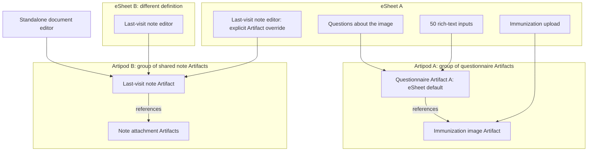

# Collaborative Artifact editing, MIME email, and MDY support: implementation plan

Status: draft for review, updated from the agreed storage and collaboration model.
This plan coordinates `mieweb/kerebron`, `mieweb/artipod`, `mieweb/eSheet`,
`mieweb/yorm`, and `mieweb/ui`. The draft planning PR and its tracking ticket
support review of this document. Repository-specific implementation tickets,
owner notifications, and implementation PRs follow plan review. This change
contains the plan only.

## Goal and delivery approach

Build a collaborative rich-media component on protected Artipod storage that
handles almost all message display and composition work for an email client.
An IMAP client should be able to pass in a fetched raw message and obtain a
usable message view/composer with minimal integration. The component handles
MIME parsing/writing, body selection, message headers, inline images/video,
attachments, and approved external media references.

MIME email is a first-class use case covering both display and composition.
Prefer MDY for systems that do not want to implement MIME: new
ordinary documents default to MDY, while new email messages use MIME. Saving
an imported message or document retains its format unless the user explicitly
exports another format.

Implement the new path alongside existing components, demonstrate compatibility,
obtain affected owners' approval, then migrate and clean up. Preserve existing
body-only editor APIs while the new component is developed. Collaboration and
eSheet scope behavior are acceptance requirements from the first implementation,
including multiple editors, users, and questionnaire definitions.

Pure Kerebron editing and MDY/MIME codecs stay framework independent. The new
collaborative media component requires Artipod's managed encrypted storage; its
production attachment path has one supported persistence implementation. MIME
and Artipod integrations stay behind explicit package entry points so ordinary
body-only consumers do not load them at startup.

Check a milestone only after its tasks and acceptance criteria have evidence.
Source investigation is completed below; there is no preliminary research milestone.

## MIME/email and MDY contract

The intended email-client integration is: fetch a raw message, pass its source
and authorized Artifact binding to the component, and consume complete-message
output through host-provided draft-save/send callbacks. The caller must not need
its own MIME parser/writer, CID resolver, body-selection rules, attachment UI,
email header editor, or HTML sanitizer. Evaluate the "almost all" goal through
that working integration and its acceptance criteria.

- **MIME/email mode:** accept complete Internet message bytes as a stream or
  protected source handle, including messages fetched over IMAP. Handle display,
  new composition, draft editing, reply, reply-all, and forwarding. Serialize a
  complete message with its headers, supported body alternatives, inline parts,
  and attachments, ready for the host's mail adapter.
- **MDY/document mode:** prefer MDY when the host does not need MIME. Offer the
  same body/media editing experience without requiring that host to construct
  message headers or multipart structures. Preserve MDY metadata and durable
  attachment references; do not invent a new MDY binary container.
- **Format selection:** honor an explicit input format/mode and declared source
  media type. Define bounded source recognition for undeclared inputs; do not
  rely only on a filename extension. In email mode, plain-only, HTML-only, and
  ordinary single-part messages stay email messages; absence of multipart
  structure or a MIME-Version header does not select MDY. Invalid declared MIME
  produces a recoverable diagnostic while retaining its source, rather than
  silently reinterpreting it as MDY. Persist the selected source format on the
  shared Artifact so every editor uses the same interpretation.
- **Serialization purpose:** distinguish source-preserving export, editable draft
  save, and delivery serialization. Source export may retain original bytes;
  draft save retains authorized draft fields, including Bcc. Delivery produces
  normalized message bytes with Bcc recipients omitted from delivered headers
  and returns the transport recipient envelope separately for the host adapter.
  The caller selects the purpose; it must not have to rewrite exported headers
  itself or treat a source/draft export as delivery output.
- **MIME conventions:** handle the message/header and part relationships needed
  for real mail: encoded and folded headers, addresses and threading, charsets,
  transfer encodings, nested multipart structures, alternative bodies, inline
  CID/Content-Location media, attachment names/dispositions, and attached messages.
  Preserve unknown parts/headers and source bytes as specified below. Explicitly
  identify unsupported media and signed/encrypted content; never discard it or
  claim that editing preserved a signature's validity.
- **Ownership:** the component and its shared codecs own message presentation,
  composition, and serialization. The host owns IMAP/SMTP or equivalent network
  adapters, account authentication, mailbox operations, sender identity, send-time
  policy, and transport recipient envelopes, plus existing authorization/storage
  services. Those callbacks must remain small; MIME work belongs in the component
  and codecs rather than being repeated by each mail client.

M3 supplies the message model/codecs, M5 supplies usable email display/composition,
and M6 proves the minimal mail-client integration. This contract uses the same
Artipod, collaboration, shared-scope, and lifecycle requirements as document mode.

The first MVP uses embedded synthetic raw MIME messages and a hardcoded MDY
document in Storybook. An actual IMAP server or mail account is not required for
that check-in. These fixtures enter through the same raw-source contract that a
future IMAP adapter will use; the component still owns parsing and presentation.

## Milestone tracker

- [ ] M1 — Shared bindings, Artifact scopes, and acceptance fixtures implemented.
- [ ] M2 — Protected Artipod storage, streaming, and shared lifecycle validated.
- [ ] M3 — Kerebron shared-body bindings, MIME message codecs, and MDY preservation work.
- [ ] M4 — eSheet and yorm support inherited scopes and shared document references.
- [ ] M5 — Experimental UI demonstrates email display/composition and shared eSheet editing.
- [ ] M6 — Integration, owner approvals, and coordinated releases are complete.
- [ ] M7 — Approved existing callers migrate incrementally.
- [ ] M8 — Approved deprecations and duplicate-code cleanup are complete.

## Terminology, identity, and ownership

| Term                   | Meaning                                                                                                                                                |
| ---------------------- | ------------------------------------------------------------------------------------------------------------------------------------------------------ |
| **Artifact**           | An individual document, image, attachment, or other item.                                                                                              |
| **Artipod**            | A group of Artifacts, with storage, synchronization, and history. It can contain many documents and attachments.                                       |
| **Artifact reference** | A stable logical reference identifying an Artifact and the Artipod in which it is accessed. Resolve it through the authorized host service.            |
| **Artifact scope**     | The default Artifact reference inherited by a form/group/input, plus its resolved Artipod and access context.                                          |
| **StorageSession**     | Artipod's application-owned protected browser storage root/vault. Multiple Artipods and editor views share that session.                               |
| **DocumentSession**    | The existing yorm handle for a shared document. Reuse it where yorm is present; this work does not introduce a competing session/store with that name. |
| **Body binding**       | A borrowed connection from an editor view to a specific body/field in host-owned shared document state.                                                |

Keep Artifact identity, Artipod identity, questionnaire response identity, definition
ID, field/row identity, Yjs root identity, and immutable saved revision distinct.
A path, OCI ref head, or DOM instance ID is not automatically an Artifact ID or an
authorization grant. Resolve logical IDs to storage using the host's registry.

The host owns the live canonical state and its authorization. yorm/Yjs synchronize
that state; eSheet FormStore is the existing local or derived response view;
Kerebron edits a bound body. Artipod persists saved CRDT snapshots, Artifact
contents, source envelopes, and attachment bytes. The UI holds temporary view
state and scoped leases. Avoid a second mutable copy of canonical form answers,
rich text, or attachment metadata in a new document wrapper.

One application-owned protected StorageSession serves the page. A registry opens
and shares authorized Artipod/Artifact bindings across consumers. Inputs borrow
handles and detach independently. Closing one input, form, or editor does not
close a shared root or delete an Artifact still referenced elsewhere. Separate
Artipods are logical groups under that storage service, not separate browser roots.

## eSheet Artifact scope and override contract

The following API names are proposed additions, not existing eSheet SDK features:

- The rendered eSheet instance has an optional default `artifact` reference.
- A question input may supply its own explicit `artifact` reference, overriding
  the inherited default for that input. Component groups can establish a nearer
  default scope through a provider using the same resolution rule.
- A definition can declare a binding/resolver; the host supplies actual references
  from questionnaire instance data or the question's document-reference response.
  Reusing a definition does not automatically reuse a previous patient's Artifact.
- A document-reference question edits the referenced Artifact's shared body.
  Its response stores the reference/binding; it does not clone the target document
  into a second authoritative answer value.

```ts
// Conceptual resolution; resolved references still require authorization.
effectiveArtifact =
  question.artifact ?? nearestScope.artifact ?? esheet.artifact;
```

The default is optional for attachment-free operation. Before upload, paste,
recording, or attachment persistence, an effective Artifact and live protected
Artipod context must exist. The host may provision the default on first use;
acquire and record it successfully before accepting persistent media writes.
Provisioning is a host-coordinated, idempotent get-or-create operation keyed by
the stable questionnaire response identity. Simultaneous first uploads from
fields, tabs, or users must atomically select the same reference and retain it
across reopen; definition IDs and DOM IDs are not provisioning keys.
A missing, denied, or unavailable explicit override produces a visible error.
It must not redirect a write to the eSheet default.

Fifty ordinary text inputs can inherit one default Artifact and its Artipod while
retaining separate body/field identities, including stable repeating-row identity.
An override may select another Artifact in that same Artipod or an Artifact in a
different Artipod. Shared Artifact references retain the same target across users,
eSheet instances, definitions, and standalone editors. Scope inheritance selects
a target; it does not grant access to that target.

### Required example

All four inputs below belong to eSheet A. Its uploader creates an immunization
image Artifact associated with the questionnaire Artifact, in Artipod A. The 50
inputs and questions about the image keep questionnaire-specific answers there.
The last-visit input overrides the default with the shared note Artifact in
Artipod B. eSheet B and the standalone editor edit that same note.



## Repository responsibilities

| Repository        | Additive work                                                                                                                                                                                                                                                                                                  |
| ----------------- | -------------------------------------------------------------------------------------------------------------------------------------------------------------------------------------------------------------------------------------------------------------------------------------------------------------- |
| `mieweb/kerebron` | Generic borrowed body/media bindings, configurable Yjs fragment ownership, shared insertion primitives, headless MIME message/header codecs and composition helpers, and MDY codecs. Proposed codec package names: `@kerebron/documents` and `@kerebron/document-mime`; neither creates a new DocumentSession. |
| `mieweb/artipod`  | Managed protected persistence, authorized group/Artifact resolution, streaming encrypted attachment I/O, bounded caching, durability, sync, and shared consumer/lock lifecycle.                                                                                                                                |
| `mieweb/eSheet`   | First-class optional default Artifact scope, question overrides/document-reference field binding, FileStore bridge, strict schema/builder/MCP preservation, and FormStore integration.                                                                                                                         |
| `mieweb/yorm`     | Reuse existing DocumentSession; add typed body/metadata/manifest materialization and policy-safe granular bindings, protected persistence integration, and transport validation coverage.                                                                                                                      |
| `mieweb/ui`       | Provider composition, reusable MIME email display/composer and MDY document views, existing capture/annotation UI, attachment views, and minimal mail-client/Storybook/browser workflows.                                                                                                                      |
| Host application  | Authenticated identity, permissions, reference resolution/provisioning, room authorization, approved external URL policy, domain response semantics, and small mail fetch/draft-save/send/account adapters.                                                                                                    |

Suggested UI concepts are an app-level `ArtipodProvider`, an inherited
`ArtifactScopeProvider`, and an `ArtifactDocumentEditor` used by both referenced
questions and standalone editors. They receive host-owned services/references.
Production code must not open its own root/key service per input. Keep these
integrations behind an explicit entry such as `@mieweb/ui/artipod`.

## Completed planning investigation

Investigation on 2026-11-12 covered current source, published exports, contribution
guidance, existing integration models, and remote CI. These findings inform the
implementation tasks; they are not claims that the new feature already works.

### Baselines and known foundation failures

| Repository/source   | Inspected revision and evidence                                                                                                                                                                                           | Planning consequence                                                                                                               |
| ------------------- | ------------------------------------------------------------------------------------------------------------------------------------------------------------------------------------------------------------------------- | ---------------------------------------------------------------------------------------------------------------------------------- |
| UI                  | [`7aa294d`](https://github.com/mieweb/ui/commit/7aa294d430ef0e3bbaf106c3eded8a394b60c771); [exact-head CI passed](https://github.com/mieweb/ui/actions/runs/43147665598)                                                  | Keep existing body/value/ref contracts and capture baselines.                                                                      |
| Kerebron            | [`d5d5b3d`](https://github.com/mieweb/kerebron/commit/d5d5b3d4147c03f826952db1350a93972436af1b); [exact-head build/format/52 tests passed](https://github.com/mieweb/kerebron/actions/runs/43040842112); published v0.9.1 | Public upload helpers already exist; add missing shared ownership and media coverage.                                              |
| Artipod             | [`275dd693`](https://github.com/mieweb/artipod/commit/275dd693699bbfa0917651006c1ea362a5e85330), core 0.13.0; [exact-head CI partly fails](https://github.com/mieweb/artipod/actions/runs/39934856375)                    | Node/SPA/packed-consumer checks passed; encrypted browser offline reopen failed and must be fixed in M2.                           |
| eSheet upstream     | [`518885ca`](https://github.com/mieweb/eSheet/commit/518885ca9d7ef060a8450a3d22e86c7ee1af3b4a)                                                                                                                            | No first-class Artifact/Artipod API. Exact-head Actions test evidence was absent; a successful Pages check is not a test baseline. |
| eSheet pinned by UI | [`21fbf33d`](https://github.com/mieweb/eSheet/tree/21fbf33dd5a8a4d8c526406a1defc7ae0d6a3306)                                                                                                                              | Older than inspected eSheet upstream; update only through a reviewed dependency/gitlink change after upstream work lands.          |
| yorm                | [`458c9e4`](https://github.com/mieweb/yorm/commit/458c9e423d95895a29bc98b3323aa2842d6f101c); [exact-head CI passed](https://github.com/mieweb/yorm/actions/runs/32611069061)                                              | Existing session/codec/provider model is the starting point; new rich-fragment and attachment policy behavior needs tests.         |
| MDY draft           | [templit specification at `8b57fe1`](https://github.com/mieweb/templit/blob/8b57fe1c8fe7f0d149db00a64092531c4b1b1d56/doc/mdy-specification.md)                                                                            | YAML plus Markdown, with no defined binary container/attachment manifest.                                                          |

Artipod's [encrypted browser failure](https://github.com/mieweb/artipod/actions/runs/39934856375/job/120351793594)
occurs during offline reload with an unexpired wrapped grant: the page reports
`EncryptedStore: plaintext backing block refused`. Existing migration/ciphertext
and two-tab exclusion checks pass. Reproduce and fix the reopen failure while
retaining strict ciphertext checks; changing to plaintext or another backend is
not a fix.

These are remote source/CI observations, not new local test runs. Local UI and
Kerebron checkouts are older; unrelated changes include a different checked-out
eSheet submodule revision. Preserve those changes. Use isolated implementation
checkouts and normal package artifacts for cross-repository validation.

eSheet has a root `AGENTS.md`. UI, Kerebron, yorm, and Artipod had no tracked root
AGENTS/CODEOWNERS at the inspected revisions; Artipod's sample application has its
own guidance. Repository-specific commands and relevant sources are below.

### Existing contracts and gaps

- UI `RichEditor` is a string body API: Markdown by default, optional HTML,
  `getContent`/`focus` and optional media methods. Existing Yjs collaboration owns
  its body. `assetLoad` loads runtime/WASM assets, not document attachments.
- `RichMediaCaptureEditor` already composes RichEditor and CaptureDock.
  `TextAreaRichKerebron` is strictly controlled HTML with an `HTMLDivElement` ref.
  `Textarea` retains plain strings/native events and an `HTMLTextAreaElement`
  mirror. Preserve all three contracts when migrating their internals.
- `EncounterVisit` owns native responses through FormStore and retains MDY
  provenance/protected links. `RichTextEsheet` is MDY export-only. Clinical
  narrative media requires its uploader, rejects video, and projects plain
  answers; RichEdit body images are a separate case. Keep those host policies
  and the screen-capture notice. `EmailEditor` remains a block/MJML editor with
  its own email-safe controls and uploader policy.
- Kerebron 0.9.1 publicly exports `uploadMediaFiles`, `handleMediaFiles`, and
  `mediaUploadKey` through `ExtensionMediaUpload`. Reuse these primitives. They
  remain image/video URL helpers, not a persistent arbitrary-attachment store.
  Native paste/drop and the upstream image dialog also call this pipeline.
- Kerebron can accept a host Y.Doc/provider, but currently hardcodes its body
  fragment, destroys the provider on detach, and assumes a sync event for import.
  It needs explicit borrowed ownership, configurable fragments, already-synced
  attachment, per-view undo/presence policy, and exactly-once initialization.
- Kerebron's front-matter service already preserves some original source inside
  Map state. Its guard/cloning behavior is insufficient as a universal raw-byte
  contract. Keep the original envelope outside the editor tree for codec work.
- yorm already exposes DocumentSession. Its default JSON codec materializes
  only `resource`; whole-object writes rebuild that root. Use granular shared
  type transactions for live editing. XML bodies and attachment manifests need
  an explicit codec/layout and policy projection. Current proposer guards check
  `resource` only. Coordinate with open [yorm #11](https://github.com/mieweb/yorm/pull/11)
  on pre-apply validation; that work is not assumed merged.
- eSheet's current renderer creates a FormStore per instance; host bindings keep
  derived views coherent. Its `collab` prop supplies decorations/decisions, not
  synchronization. FileStore is a useful bridge. Strict definition schemas and
  normalization will reject/strip new properties unless updated upstream.
  ResponseReference is navigation-only and must retain that meaning.
- Artipod protected storage encrypts contents and filesystem metadata, but a
  shared physical vault is not per-Artifact authorization. Current ingest/hash,
  blob, encryption, and cache paths still materialize whole buffers or eagerly
  warm plaintext. Lock denies reads but does not automatically detach all UI
  consumers. M2 addresses those gaps before low-memory/privacy claims.
- Current Kerebron CI selects named test directories and will not automatically
  discover new document/media suites. Add their execution explicitly.

MDY uses `text/markdown; variant=mdy`; accept eSheet's legacy `text/x-mdy` alias.
Preserve no-op bytes, unknown YAML, and body-only front-matter bytes. Preserve
existing `#id`/`mdy:id` structured-field links and `mdy:` provenance. Host schema
resolvers and MDYT template engines remain separate work. UI-pinned eSheet has
raw-preserving utilities but its compose flow rebuilds YAML; newer upstream adds
`updateMdyForm`. Keep that distinction during migration.

## Owner notification and deprecation review

The contacts below are inferred from contributions, not formal ownership. Confirm
the accountable owner or delegate in the linked ticket/PR, with the repository
maintainer assigning one when needed. Notify every affected owner of the design,
then request review of concrete changes and any public deprecation separately.

| Area                                                          | Initial review contacts                                                                                                                               | Evidence                                                                                                                                                                                                    |
| ------------------------------------------------------------- | ----------------------------------------------------------------------------------------------------------------------------------------------------- | ----------------------------------------------------------------------------------------------------------------------------------------------------------------------------------------------------------- |
| UI capture, RichEditor, TextAreaRich, duplicate media helpers | William Garrity (`garrity-miepub`); Poonam Dharamkar (`Dharp02`) for upload/collaboration; Grzegorz Godlewski (`ggodlewski`) for Kerebron integration | [#740](https://github.com/mieweb/ui/pull/740), [#742](https://github.com/mieweb/ui/pull/742), [#486](https://github.com/mieweb/ui/pull/486), [#267](https://github.com/mieweb/ui/pull/267)                  |
| EncounterVisit / EncounterMdyEditor                           | Doug Horner (`horner`) and William Garrity                                                                                                            | [#564](https://github.com/mieweb/ui/pull/564), [#749](https://github.com/mieweb/ui/pull/749)                                                                                                                |
| EmailEditor, if affected or proposed for deprecation          | Evelyna Bellamy (`ebellamy-bh`, original contribution) and William Garrity (active maintenance)                                                       | [#550](https://github.com/mieweb/ui/pull/550), [#703](https://github.com/mieweb/ui/pull/703)                                                                                                                |
| Kerebron shared bindings/media                                | Grzegorz Godlewski; Doug Horner for host/lifecycle integration                                                                                        | [Public helper refactor](https://github.com/mieweb/kerebron/commit/2209c01e248f95fa876e8ac2becfed54859000db), [#136](https://github.com/mieweb/kerebron/pull/136)                                           |
| Artipod protected storage, ingest, lifecycle                  | Doug Horner                                                                                                                                           | [StorageSession extraction](https://github.com/mieweb/artipod/commit/1d79770baa848b1094cb32c4dddad5b7eedac054), [ingest](https://github.com/mieweb/artipod/commit/39fb30430bf68b3aa47c4a346c38069101c43ed0) |
| eSheet scopes/schema/renderer and files                       | Lin Latt (`lattln`), Doug Horner; `dcarlson-MIE` for FileStore/document-picker integration                                                            | [Current eSheet source](https://github.com/mieweb/eSheet/tree/518885ca9d7ef060a8450a3d22e86c7ee1af3b4a)                                                                                                     |
| yorm runtime/projections and transport validation             | Doug Horner; Lin Latt for ongoing validation integration                                                                                              | [Existing session](https://github.com/mieweb/yorm/blob/458c9e423d95895a29bc98b3323aa2842d6f101c/packages/yjs/src/createYorm.ts), [#11](https://github.com/mieweb/yorm/pull/11)                              |

Maintain one review-register entry per component/API: owner, exact symbols,
proposed action, replacement, consumer impact, notification/review links, and
separate migration/deprecation/removal decisions. Initial decisions are pending.
Include a working demo, behavior/API comparison, test results, migration example,
and rollback. Public deprecations additionally need approved wording/version,
support window, proposed removal release, and removal criteria.

The duplicate UI insertion implementation is an internal cleanup candidate.
Public wrapper deprecations require replacement parity and a separate owner
approval. EmailEditor's distinct block/MJML model remains supported unless a
separately justified proposal is approved. An unanswered notification or approval
of additive work does not approve a deprecation.

## M1 — Implement shared interfaces, scopes, and fixtures

Owner: all integration tracks. Prerequisite: review of this plan.

1. [ ] Add the proposed Artifact reference/scope and borrowed body/media binding
       interfaces in their owning packages. Specify identity, authorization resolution,
       lifetime ownership, fragment/layout version, and optional immutable revision.
       Kerebron receives opaque bindings, without importing Artipod/yorm SDKs.
       Define the MIME/email and MDY input/output contract above, including source
       streams/handles, persisted format selection, complete-message output, and
       small host draft-save/send callbacks.
2. [ ] Specify the default/override contract above, including nested groups,
       stable field/row paths, lazy default provisioning, explicit document-reference
       questions, and failure before attachment writes when scope is unavailable.
       Specify idempotent get-or-create and atomic reference selection for
       concurrent first uploads, including retry/reopen behavior.
3. [ ] Define Artifact acquisition/release, media registration, stream/range reads,
       cancellation, availability, and preview leases. Separate live shared metadata
       from binary bytes, credentials, progress, and local preview URLs.
4. [ ] Define live editing versus saving: host-owned Y.Doc/session, granular edits,
       one initializer, explicit snapshots, and saved-revision tracking. Capture full
       Yjs state with deletion history, root-layout version, and immutable attachment
       revisions. State vectors alone do not identify deletion-only revisions.
5. [ ] Define scope/permission boundaries and the central lock/recovery contract.
       All persistent bodies, envelopes, metadata, attachment/derived files and
       browser CRDT snapshots use protected Artipod storage. No plaintext persistence
       fallback or hidden unmanaged cache is permitted in this component.
       Scope cached bindings to the authorized principal/audience. Separately
       require authenticated, authorized WSS/TLS for live body, metadata, proposal
       and awareness traffic; Artipod storage/sync encryption does not protect
       that channel automatically. Record whether the server is trusted with
       plaintext or stronger end-to-end transport protection is required.
6. [ ] Define a numeric transfer/cache memory budget, maximum concurrent buffers,
       representative large-file sizes above that budget, preview limits, and quota
       failure behavior. Streaming must cover import, hashing, encryption, transfer,
       playback, finalization, and export.
7. [ ] Commit synthetic fixtures and an expected-results manifest covering the
       acceptance matrix. Include the exact eSheet A/B/standalone example, multiple
       users, denied overrides, nested MIME, and small/large media with known hashes.
       Include raw fetched-mail fixtures, email display/composition expectations,
       MDY inputs, and invalid or undeclared source-format cases.
8. [ ] Notify the review contacts, confirm accountable owners, and create the
       review register. Review concrete TypeScript interfaces, layout/permission
       rules, and fixture expectations across repositories before parallel coding.

Done when: each track can implement against shared interfaces and fixtures;
Artifact/Artipod distinctions, scope resolution, authority, snapshot semantics,
privacy lifecycle, memory budgets, and minimal MIME/email versus MDY integration
contracts are explicit. Owner decisions are tracked.

## M2 — Establish protected Artipod storage and lifecycle

Owner: `mieweb/artipod`, with host integration. Prerequisite: M1. Develop alongside
M3–M5; this milestone must pass before the joint integration gate.

1. [ ] Reproduce and fix the recorded encrypted offline-reopen failure. Retain
       strict ciphertext checks and test authenticated reload with an unexpired grant,
       expired grant, malformed storage, failure/recovery, and backend reopening.
2. [ ] Add/reuse one application-owned protected StorageSession and a registry
       for multiple authorized Artipods/Artifacts. Require encrypted protection for
       persistent component use. Apply host/group/Artifact permissions before open
       and write; a shared vault or copied context is not an authorization grant.
3. [ ] Supply borrowed scope handles under the same vault for default and
       overridden Artifacts. Ref-count consumers or use equivalent explicit ownership.
       Opening Artipod B must not replace Artipod A's root or disrupt its editors.
4. [ ] Add public bounded streaming/range APIs and incremental hashing. Remove
       whole-file rereads at ingest finalization, full-buffer encrypted I/O where it
       breaks the budget, and eager unbounded plaintext warming. Keep changes in
       Artipod rather than implementing another storage system in the UI.
5. [ ] Implement backpressure, cancellation, partial-write recovery, quota handling,
       encrypted temporary outputs, and durable flush/error reporting. Finalize an
       immutable attachment revision before publishing it as ready in shared state.
       Preserve pending local captures on recoverable failures under the agreed policy.
6. [ ] Centralize lock/expiry/logout/account-switch callbacks for all registered
       consumers: stop reads/recording/workers, revoke preview leases, detach decoded
       media, and release decrypted view/cache references. Closing a view releases
       only its leases. Document draft recovery; do not claim JavaScript zeroization.
7. [ ] Persist coherent canonical snapshots and their referenced Artifact versions.
       Verify configured encrypted sync includes all reachable content and metadata.
       Retain versions for undo/export/history; unlinking a field or closing an editor
       does not physically delete shared content. Storage retention owns garbage collection.
8. [ ] Test real encrypted OPFS with large files, several Artipods, 50 consumers,
       lock during upload/export, interrupted sync, and reopen. Measure memory during
       finalization and playback as well as transfer. Include packed-public-package
       tests so internal imports cannot hide missing supported APIs.

Done when: encrypted offline reopen passes, multiple logical scopes share one
protected root safely, large-file operations meet the measured memory budget,
and saved state never advances after a failed flush. Lock and consumer lifetimes
are verified across shared inputs and separate referenced documents.

## M3 — Implement Kerebron bindings and MDY/MIME codecs

Owner: `mieweb/kerebron`. Prerequisite: M1. Use the agreed storage/binding contract
while M2 is built; exercise the real adapter at M6.

1. [ ] Add headless codec/binding exports and workspace registration. Preserve
       existing byte/string converter and URL-media APIs. Do not add another
       DocumentSession or make Kerebron core open storage, rooms, or key services.
2. [ ] Support host-provided Y.Doc, named/nested body fragments, provider/awareness,
       and explicit borrowed ownership. Handle already-synced providers. Detaching
       one editor must not destroy another editor's transport or shared state.
3. [ ] Implement exactly-once initialization, per-view origin/undo/presence policy,
       and stable body/row targeting. Live updates use shared transactions; serialization
       is an import/export boundary, not a keystroke synchronization loop.
4. [ ] Extend the existing public media primitives for the document-aware path.
       Register attachments as Artifacts through the adapter, publish small immutable
       references, and resolve local previews/range-capable media without persisting
       blob URLs. Retain support for arbitrary files without an inline schema node.
5. [ ] Route opt-in paste/drop, capture, annotation, and image-dialog behavior
       through that service. Recheck target generation and read-only/access state
       immediately before dispatch. Map pending targets through edits. Replacing one
       image occurrence must preserve other occurrences and referenced old revisions.
6. [ ] Implement MDY using the existing front-matter service boundary and preserved
       raw source. Preserve unknown keys, comments, quoting, line endings, field links,
       and no-op source. Explicit metadata edits must actually update metadata.
       MDY exports need durable representable media URLs or an explicit loss/error
       result; do not invent an MDY binary manifest. Make this the preferred
       ordinary-document path for hosts that do not need MIME.
7. [ ] Select a MIME parser/writer using an incremental-processing fixture spike.
       Verify Deno/browser/npm compatibility, license, and measured memory behavior.
       Stream original source and decoded attachments to protected storage; keep
       source handles/part metadata instead of a complete message string in the view.
       Check conformance against the MIME/message standards in the source map and
       the interoperability fixture manifest, rather than a few HTML-email samples.
8. [ ] Implement nested mixed/alternative/related bodies, charset/base64/quoted-
       printable decoding, CID/Content-Location scope, filenames/dispositions, repeated
       headers, attached messages, external references, and opaque unknown parts.
       Select the supported body and retain original source/part relationships.
       Support plain-only/HTML-only messages, encoded/folded and internationalized
       headers/addresses, Unicode subjects/display names/filenames, and continued/
       encoded MIME parameters. Follow host transport capabilities for outgoing
       internationalized mail and surface incompatibilities before send.
       Include fixtures for realistic imperfect mail with recoverable diagnostics.
9. [ ] Sanitize rendering, apply remote-media policy before assigning DOM URLs,
       report unsupported formatting, and preserve signed/encrypted messages as opaque
       read-only source initially. Edited export regenerates supported HTML/plain-text
       alternatives together; unchanged source export streams original bytes.
       External fetch/preview must use the host's managed cache policy, covering
       HTTP and service-worker caches. If that policy cannot be enforced, retain
       the URL without fetching; URL approval alone does not protect cached bytes.
10. [ ] Export from an immutable host snapshot with pinned attachment revisions.
        Stream encoding/output; explicit authorized download/export is a separate host
        action from automatic browser persistence. Add codec/media/multi-editor tests
        to normal CI, including source preservation and concurrent snapshot export.
11. [ ] Implement the shared message-header model and complete-message writer:
        From/Reply-To, To/Cc/Bcc, Subject, Date/Message-ID, and reply-threading fields.
        Keep message headers distinct from rich-text bodies and the host's transport
        recipient envelope. Preserve imported headers; encode/fold new values,
        validate edits, and prevent header injection. Keep Bcc recipients out of
        delivered headers while retaining authorized draft/transport information.
        Expose distinct source export, draft-save, and delivery purposes; delivery
        returns normalized message bytes and the recipient envelope separately.
        Define host overrides for sender identity and send-time values. Add reply,
        reply-all, quoting, and inline/attached-message forward helpers so clients
        do not implement their own message-rewriting rules.
12. [ ] Implement deterministic MIME/email versus MDY routing from the agreed
        contract. New email composition produces MIME; non-MIME document hosts
        default to MDY. Recognized or declared email never silently becomes MDY
        after a parser failure. Persist format with the shared Artifact and test
        consistent routing across reopen and multiple editors.

Done when: two borrowed editor views converge and detach safely; MDY preserves
its envelope; complete MIME messages can be displayed, composed, replied to,
forwarded, and reopened with intact headers, media, and unknown parts. The host
does not implement MIME interpretation or message rewriting. Large attachments
remain outside Y.Doc/whole-message buffers, and unsupported/lossy conversions
are reported without discarding the source.

## M4 — Implement eSheet and yorm integrations

Owner: `mieweb/eSheet` and `mieweb/yorm`, as separate upstream PRs.
Prerequisite: M1; develop alongside M2/M3/M5.

1. [ ] Add optional runtime default Artifact scope and typed question overrides
       to eSheet's official provider/field interfaces. Keep actual references instance-
       bound; reusable definitions declare bindings. Update strict TypeScript/Zod/JSON
       schemas, normalize/hydrate allowlists, builder/MCP edit paths, and round-trip
       tests for any persisted declarations. Avoid unsupported casts/unknown properties.
2. [ ] Add an explicit editable document-reference field/binding. Preserve the
       navigation-only ResponseReference and document-row ID/file-reference contracts.
       The reference points to the shared target; ordinary answers remain owned by
       their questionnaire. Row reorder/remount must preserve both identities.
3. [ ] Bridge eSheet FileStore and rich fields to the resolved protected scope.
       Implement lazy default provisioning and visible missing/denied states. An
       explicit failed override never falls back. Document detach/unlink behavior
       without deleting shared external Artifacts or Artipods.
       Exercise concurrent first uploads through one idempotent get-or-create
       operation, atomically recording the selected default before media writes.
4. [ ] Reuse yorm DocumentSession and host shared types. Bind each eSheet FormStore
       as the existing derived/local view using granular updates and origin markers.
       Borrow body fragments by stable Artifact/field identity; do not create a second
       FormStore or copy external documents into authoritative response strings.
5. [ ] Register a typed yorm DocumentCodec/layout for resource data, rich fragments,
       attachment references and intended envelope metadata. Keep binary/source bytes
       in Artipod. Whole-object codec writes serve initialization/explicit replacement;
       normal field/text edits must preserve other roots and unknown data.
6. [ ] Extend role/proposal/read-only validation and policy materialization to every
       registered root, coordinating with yorm #11. Test canonical and derived/lens
       documents separately; reject unsupported configurations explicitly. Cover
       offline SyncStep2 and mixed allowed/forbidden updates before persistence/fan-out.
       Reject unauthorized introduced/unknown roots and CRDT mutations that leave
       visible JSON unchanged. Preserve unknown domain fields during valid edits
       without treating that preservation as permission to write arbitrary roots.
       Test live transport authorization and protected connection configuration.
7. [ ] Wire protected saved-snapshot persistence and consistent exports. Capture
       complete canonical Yjs history/layout and immutable attachment versions. Mark
       only that revision saved; newer edits remain dirty. Merge compatible offline
       CRDT histories, retaining deletions. Distinguish canonical lineage from role
       lenses and incompatible schema/identity; surface conflicts explicitly.
8. [ ] Test two forms plus a standalone editor, 50 fields, two different Artipods,
       concurrent form/prose/media edits, read-only peers, denied references, and
       delete/undo/offline recovery. Repeated Artipod notifications must not reload
       MIME/MDY or reseed a live Y.Doc. Extend transport conformance and demo E2E tests.

Done when: eSheet defaults/overrides survive all supported definition and response
paths, referenced documents retain one canonical identity, and collaborative body,
form and attachment changes converge with correct permissions and saved revisions.
Code is reviewed in its upstream repository before UI consumes a new package/pin.

## M5 — Build the parallel UI and required example

Owner: `mieweb/ui`. Prerequisite: M1. Build against a small interface fake while
upstream tracks progress; complete validation with real released/build artifacts.

1. [ ] Add the proposed provider and ArtifactDocumentEditor through an isolated
       integration entry point. Receive the existing Artipod storage service and host
       binding registry. Use the same editor for standalone and document-reference
       questions; provide an explicit new-Artifact creation action when needed.
2. [ ] Compose existing RichEditor, CaptureDock, recording, scan and annotation
       UI. Default uploads use inherited Artifact scope; explicit question references
       override it. Keep each field's own body identity in a shared scope.
3. [ ] Build an accessible attachment list with availability/progress, open/download,
       reference removal, and version-safe annotation. Distinguish pending transfer,
       unavailable/locked storage, denied target, missing media, and unsupported codec.
4. [ ] Implement the exact diagram as Storybook/integration fixtures: eSheet A
       contains uploader + 50 inputs + image questions + last-visit reference. Default
       content/attachments use Artipod A; the last-visit Artifact in Artipod B is also
       open in eSheet B with another definition and in a standalone editor.
5. [ ] Demonstrate optional sheet default, first-attachment provisioning, same-pod
       and cross-pod overrides, and two independent responses using one definition.
       Show that an override applies only to its field/group and leaves siblings intact.
6. [ ] Connect saves to host snapshot/export barriers and real pending operations.
       Preserve edits on failures, cancel stale scoped completions, release view leases,
       and respond centrally to lock/account changes. A component unmount must not
       close shared sessions/providers or delete referenced bytes.
7. [ ] Add MDY/MIME import, source-format save, and explicit export stories. Dispose
       views and reopen saved Artifacts in fresh instances to prove durability.
       Do not use story mock object URLs as persistence evidence.
       Add usable email display and composer modes with header/recipient controls,
       body alternatives, inline media, attachment management, new message, edit
       draft, reply/reply-all, and both inline and attached-message forwarding.
       Supply accessible pending/error states and host draft-save/send callbacks.
       Pass draft serialization to draft-save callbacks and delivery bytes plus
       the separate recipient envelope to send callbacks.
8. [ ] Follow theme/labels/accessibility/RTL/catalog conventions and document provider
       ownership, reference behavior, limitations, and migration examples. Add focused
       unit tests, browser collaboration/storage tests, and reviewed visual baselines.
       Keep fakes in stories/tests, without a production plaintext fallback.
9. [ ] Build the minimal mail-client harness first with embedded synthetic raw
       MIME fixtures and a hardcoded MDY document in Storybook. No actual IMAP
       server or mail account is required. The harness supplies raw source,
       authorized Artipod bindings, and draft-save/send callbacks; replacing its
       fixture loader with a future IMAP fetch must not change the editor contract.
       The adapter contains no MIME parser, CID mapping, body-selection,
       attachment-rendering, or message-rewriting logic. Send prepares complete
       message bytes and an envelope for inspection; this demo transmits no mail.
       Show the same component in an MDY-only host without mail configuration.

### First MVP check-in within M5

This is the first user-testable review point, before completing the broader M5
example and M6 acceptance gate. Provide working Storybook links and reproducible
steps when the following checks pass:

- [x] Display embedded synthetic plain, HTML-only, nested multipart, and Unicode
      email fixtures, including a CID image and a separate attachment. Outside
      media remains unfetched under the preview policy.
- [x] Reply or edit a draft, change its body/headers, attach a small synthetic
      file, and serialize complete MIME. Distinguish draft and delivery output;
      delivery returns the transport envelope separately and omits Bcc headers.
- [x] Save the canonical email draft and immutable attachment references through
      real encrypted OPFS, dispose its views, and reopen the same saved Artifact.
      Verify the saved body and attachment bytes rather than a surviving object URL.
- [x] Edit the hardcoded MDY document, preserve its front matter, save through
      protected storage, and reopen it without mail-specific configuration.
- [x] Open two editor views of the same canonical body; an edit in either appears
      in the other. Detaching one leaves the other and the shared session usable.
      Exercise lock/unlock and release decrypted previews when locked.
- [x] Document the initial 10 MiB buffered-object/message limit and the synthetic
      demo key setup. The demo may retain a nonextractable key in IndexedDB for
      reload, but supplies no account authentication and accepts synthetic data only.

Evidence recorded November 12, 2026: [UI Storybook MVP PR #757](https://github.com/mieweb/ui/pull/757), [Kerebron PR #164](https://github.com/mieweb/kerebron/pull/164), and [Artipod PR #148](https://github.com/mieweb/artipod/pull/148). The local browser workflow verified the checks above, including full MDY reload and sibling detach/remount. UI validation passed 2,755 unit tests, typecheck, lint, formatting, package build, and static Storybook build. The authored CLI browser suite still needs execution; no visual baselines or release approvals are implied by this checkpoint.

Passing this checkpoint does not complete M2, M5, or M6. Full bounded-memory
streaming/cache behavior, authenticated remote-user collaboration transport,
production key/authorization integration, 50-field eSheet default/override and
cross-sheet scenarios, and the full acceptance matrix remain milestone gates.

Done when: the required example works concurrently with real protected storage,
shared defaults and isolated overrides; imported media survives save/reopen;
50 views do not create 50 storage roots or duplicate binary caches. The mail-client
harness demonstrates minimal caller glue for display/composition, and an MDY-only
host uses the preferred simpler format. Existing components still run on their
established path while these examples are reviewed.

## M6 — Integration, owner approvals, and releases

Owner: all repositories. Prerequisites: M2–M5. This gate precedes existing caller
migration, public deprecation notices, and duplicate implementation removal.

1. [ ] Test installable artifacts through public entry points. Use isolated
       integration checkouts and pinned local/prerelease packages during development;
       remove machine-specific paths and temporary overrides from mergeable manifests.
2. [ ] Run the full acceptance matrix and repository checks below. Record exact
       versions, fixture hashes, memory measurements, browser storage inspections,
       and reproducible multi-user demo steps in the linked PRs.
       Review the minimal mail-client adapter to verify that fetching/displaying
       mail and composing replies require no client-specific MIME implementation.
       Verify outgoing messages with an independent mail parser/client as well
       as component reopen; document remaining unsupported content explicitly.
       Extend the first Storybook checkpoint with production key/authorization
       integration, authenticated remote-user transport, bounded large-file
       streaming/cache measurements, and the 50-field/cross-sheet eSheet example.
       A synthetic local demo or a 10 MiB object cap does not satisfy those gates.
3. [ ] Verify existing body-only APIs, upload handlers, form events/refs, HTML/plain
       contracts, MDY provenance, clinical/email policies, and collaboration behavior.
       Verify one compatible Yjs/ProseMirror dependency graph and optional entry loading.
4. [ ] Close the recorded Artipod foundation failure and new permission/streaming
       blockers. Include real browser encrypted reopen, offline merge and lock evidence.
       Passing only mock/in-memory tests does not satisfy this gate.
5. [ ] Notify each confirmed component owner with the concrete demo/diff, API and
       behavior comparison, migration instructions, test results and rollback. Obtain
       recorded approval for each component's proposed migration.
6. [ ] Obtain separate owner approval for each proposed public deprecation: exact
       symbols, replacement parity, wording/version, transition period and removal
       criteria/release. Keep unanswered or rejected proposals pending and supported.
7. [ ] Review the dependency graph across PRs. Release Artipod and Kerebron
       foundations, then yorm/eSheet integrations once their dependencies exist, then
       UI integration. Break package cycles through host interfaces and test fixtures;
       use the repositories' existing release processes and yorm Changesets.
8. [ ] Pin actual available versions, update UI's eSheet gitlink/dependencies through
       a separate reviewed change, and rerun affected integration checks. Preserve
       unrelated local submodule state. Record exact version/revision combinations.
9. [ ] Obtain repository maintainer acceptance of the complete example and owner
       decisions. Keep previous components available until their approved migration.

Done when: the additive feature is available through normal packages, all required
acceptance evidence is recorded, and each planned migration/deprecation has its
own owner decision. Deferred proposals remain supported and tracked.

## M7 — Migrate approved callers incrementally

Owner: owning repository per caller. Prerequisite: M6 and per-component approval.

1. [ ] Migrate RichMediaCaptureEditor's internals first. Preserve props, ref methods,
       body output and capture behavior. Use compatibility adapters for existing
       URL/body-only/collaborative callers; do not insert unresolved local Artifact IDs.
2. [ ] Migrate TextAreaRichKerebron's opt-in capture path. Preserve strict HTML,
       macros, variables/dictation, editable-div ref, disabled/read-only behavior,
       capture toggle, mount-time configuration, selection and undo.
3. [ ] Migrate EncounterMdyEditor/EncounterVisit at the approved boundary. Preserve
       FormStore authority, native/protected IDs, metadata/projections, save ordering,
       sanitizer/upload policy, narrative/RichEdit distinction and capture notice.
4. [ ] Migrate native Kerebron paste/drop/image-dialog callers to compatibility
       adapters over shared media primitives without changing legacy defaults.
5. [ ] Adopt first-class eSheet defaults/document-reference inputs in the agreed
       consumers. Existing attachment-free sheets remain valid. Keep FileStore,
       reference/row identity and host-supplied authority explicit.
6. [ ] Classify remaining callers as migrated, compatible unchanged, or deferred.
       Keep Textarea's native/plain contract, RichTextEsheet's established response
       model, and EmailEditor's block/MJML model unless separately approved otherwise.
7. [ ] Run affected unit/browser/visual suites after each caller change. Ask its
       owner to review the actual migration PR and approve before merge; renew review
       for material scope changes. Preserve a documented return to the old adapter.

Done when: approved callers use the shared foundation, legacy contracts pass,
and every remaining caller has an explicit supported/deferred disposition.

## M8 — Approved deprecations and cleanup

Owner: all affected repositories. Prerequisite: M7 and owner approval of each
specific deletion/deprecation, with completed caller migration evidence.

1. [ ] Remove UI's duplicate `src/components/RichEditor/insertMediaFiles.ts` only
       after released Kerebron behavior replaces all required insertion/replacement
       paths. Remove redundant implementations, not the useful capture UI composition.
2. [ ] Remove temporary adapters, flags, fake integration paths and redundant
       storage/body caches. Keep established public compatibility facades while their
       agreed support windows are active. Remove public APIs only in their separately
       approved release after removal criteria pass.
3. [ ] Consolidate generic MDY handling through the new codecs where ownership
       permits. Preserve eSheet's current upstream metadata helper behavior; make
       source changes and dependency/gitlink updates in their respective reviewed PRs.
4. [ ] Update consumer examples, provider/maintainer notes, release/migration
       guidance, approved deprecation notices and owner-register decisions. Explain
       Artifact versus Artipod, app/shared ownership, default/override resolution,
       protected lifecycle, collaboration, formats and memory limits.
5. [ ] Run full required checks and the acceptance matrix after final removals.
       Verify imports, published versions, privacy lifecycle and old API compatibility.
6. [ ] Close completed tracking tickets with notification/approval and validation
       links. Keep future public removals and deferred integrations in follow-ups.

Done when: redundant code is gone, approved deprecations are documented, supported
APIs pass, and storage/collaboration ownership is consistent across all consumers.

## Acceptance matrix

Use real protected browser storage and multiple independent editor connections
where indicated. Tests must reopen saved content after disposing preview URLs.

| Case                                | Required result                                                                                                                                                                                                                                             |
| ----------------------------------- | ----------------------------------------------------------------------------------------------------------------------------------------------------------------------------------------------------------------------------------------------------------- |
| Terminology/identity                | Artifacts are items, Artipods group them. Artifact/field/row/definition/document IDs and saved revisions remain distinct.                                                                                                                                   |
| eSheet A default                    | Uploader, 50 inputs and image questions share the default Artifact scope/Artipod A; each field retains independent content. Last-visit editor is also inside A.                                                                                             |
| Explicit override                   | Last-visit input selects its referenced Artifact in Artipod B; default siblings stay in A. Same-pod overrides also work.                                                                                                                                    |
| Missing default                     | Attachment-free sheet works. First attachment provisions an authorized default or fails before persistent writes.                                                                                                                                           |
| Concurrent first attachments        | Two fields/tabs/users with no default use one host-coordinated get-or-create keyed by response identity; both retain the same authorized default after retry and reopen.                                                                                    |
| Denied/unavailable override         | Clear state, no default fallback, no unauthorized read/write and no wrong-record capture completion.                                                                                                                                                        |
| Cross-sheet document                | eSheet A, another definition/instance, another user and a standalone editor converge on the same note Artifact without cloning it.                                                                                                                          |
| Same definition, separate responses | Defaults remain isolated unless the host explicitly binds the same Artifact. Remount/reordered rows preserve stable identities.                                                                                                                             |
| Shared lifecycle                    | One app-owned root serves multiple Artipods and 50 views. Detaching one input leaves others working; deleting a sheet reference leaves shared documents intact.                                                                                             |
| Collaborative bodies/fields         | Two views of one body and two distinct bodies converge; concurrent form/prose changes survive; undo/origins/presence are scoped correctly.                                                                                                                  |
| Host authority/policy               | No second canonical store; read-only peers receive updates. Unauthorized registered/introduced-root mutations, including changes invisible in JSON, are rejected before persistence/fan-out for Update and SyncStep2.                                       |
| Snapshot/export race                | Full snapshot including deletion history is coherent with attachment versions; newer live edits remain dirty after export completion.                                                                                                                       |
| Offline/reordered sync              | Compatible canonical histories merge add/delete/replace without resurrecting content; duplicate notifications do not reseed. Incompatible lineage/schema is an explicit conflict.                                                                           |
| Large encrypted attachments         | Real OPFS ingest, hashing, encryption, save/reopen, transfer, playback and MIME export stay within the documented memory/cache budget; quotas and aborts are handled.                                                                                       |
| Encrypted restart/lock              | Unexpired-grant offline reopen works. Persisted source, names, metadata, thumbnails and scratch outputs contain no plaintext test marker; expiry/logout/account switch stops access/views and requires authorized recovery.                                 |
| Live collaboration transport        | Authenticated, authorized protected connections cover body, metadata, proposals and awareness; room/Artifact denial and account changes cannot leak or replay unauthorized state.                                                                           |
| External media cache policy         | Approved external URLs use the managed fetch/preview policy; ungoverned HTTP/service-worker caching is blocked or the reference remains unfetched.                                                                                                          |
| Upload/save failures                | No ready reference before durable bytes, no saved revision on failed flush, no stale insertion after scope change/lock. Pending capture recovery and partial cleanup follow policy.                                                                         |
| Minimal mail-client integration     | Host fetches a raw message stream, supplies authorized bindings, and consumes output for save/send. Display and reply with attachments require no caller MIME parser, CID resolver, body-selection logic, attachment UI, or message rewriting.              |
| Email display/composition           | Plain-only, HTML-only and nested multipart messages display; new message, draft edit, reply/reply-all and both forward modes serialize complete messages accepted by an independent parser/client. Headers, recipients and threading are correct.           |
| Serialization purposes              | Source export preserves no-op bytes; draft save retains authorized Bcc/draft data; delivery omits Bcc recipients from headers and returns their transport envelope separately. The host never rewrites MIME to make an export sendable.                     |
| Header/encoding interoperability    | Encoded/folded/repeated and internationalized headers, Unicode filenames and continued parameters survive. Outgoing alternatives, boundaries and encodings are coherent; edited headers cannot inject fields; Bcc recipients stay out of delivered headers. |
| Format selection                    | Email input and new email use MIME; non-MIME document hosts prefer MDY. Single-part mail stays email; invalid declared MIME retains source and reports diagnostics. Format remains consistent across editors and reopen.                                    |
| Primary MIME email                  | HTML/plain bodies, CID image, MP4, PDF, unknown part and external media survive paragraph edit + capture + attachment + export/reopen; decoded untouched hashes match.                                                                                      |
| MIME structure/source               | Nested alternative/related ordering, CID/location scope, repeated headers, filenames and attached messages survive. No-edit export reproduces source bytes.                                                                                                 |
| MDY preservation                    | Non-MIME document hosts default to MDY without mail configuration; body edits preserve raw YAML; explicit metadata changes work; unknown fields and protected links survive.                                                                                |
| Unsupported/lossy export            | Unknown/signed/encrypted content retained with explicit limits; missing references or unrepresentable MDY assets reported without silent loss.                                                                                                              |
| Legacy consumers                    | Existing body strings, URL media, native events/refs, HTML rejection behavior, clinical/email policies and collaboration keep their recorded contracts.                                                                                                     |
| Approvals                           | Every migration, public deprecation and removal has the applicable recorded owner approval and published replacement/version evidence.                                                                                                                      |

## Source map

Links identify inspected implementations; API names proposed above require the
new work. Follow each repository's own contributor/agent guidance.

- **Kerebron:** [CoreEditor](https://github.com/mieweb/kerebron/blob/d5d5b3d4147c03f826952db1350a93972436af1b/packages/editor/src/CoreEditor.ts), [Yjs binding](https://github.com/mieweb/kerebron/blob/d5d5b3d4147c03f826952db1350a93972436af1b/packages/extension-yjs/src/binding/PmYjsBinding.ts), [public upload helpers](https://github.com/mieweb/kerebron/blob/d5d5b3d4147c03f826952db1350a93972436af1b/packages/extension-basic-editor/src/media/ExtensionMediaUpload.ts), [front matter](https://github.com/mieweb/kerebron/blob/d5d5b3d4147c03f826952db1350a93972436af1b/packages/editor/src/utilities/frontmatter.ts), [workspace tasks](https://github.com/mieweb/kerebron/blob/d5d5b3d4147c03f826952db1350a93972436af1b/deno.json).
- **Artipod:** [managed encryption boundary](https://github.com/mieweb/artipod/blob/275dd693699bbfa0917651006c1ea362a5e85330/docs/encryption.md), [StorageSession](https://github.com/mieweb/artipod/blob/275dd693699bbfa0917651006c1ea362a5e85330/src/storage/session.ts), [eager cache](https://github.com/mieweb/artipod/blob/275dd693699bbfa0917651006c1ea362a5e85330/src/storage/encrypted-store.ts), [ingest](https://github.com/mieweb/artipod/blob/275dd693699bbfa0917651006c1ea362a5e85330/src/sandbox/ingest.ts), [sync/Yjs composition](https://github.com/mieweb/artipod/blob/275dd693699bbfa0917651006c1ea362a5e85330/docs/sync.md#composing-with-yjs-yorm).
- **eSheet:** [root guidance](https://github.com/mieweb/eSheet/blob/518885ca9d7ef060a8450a3d22e86c7ee1af3b4a/AGENTS.md), [renderer](https://github.com/mieweb/eSheet/blob/518885ca9d7ef060a8450a3d22e86c7ee1af3b4a/packages/renderer/src/lib/EsheetRenderer.tsx), [strict definitions](https://github.com/mieweb/eSheet/blob/518885ca9d7ef060a8450a3d22e86c7ee1af3b4a/packages/core/src/lib/types.ts), [FileStore](https://github.com/mieweb/eSheet/blob/518885ca9d7ef060a8450a3d22e86c7ee1af3b4a/packages/core/src/lib/file-store.ts), [collaboration contract](https://github.com/mieweb/eSheet/blob/518885ca9d7ef060a8450a3d22e86c7ee1af3b4a/apps/docs/docs/advanced/collaboration.md), [upstream MDY helpers](https://github.com/mieweb/eSheet/blob/518885ca9d7ef060a8450a3d22e86c7ee1af3b4a/packages/fields-documents/src/mdy.ts).
- **yorm:** [DocumentSession](https://github.com/mieweb/yorm/blob/458c9e423d95895a29bc98b3323aa2842d6f101c/packages/yjs/src/createYorm.ts), [JSON codec](https://github.com/mieweb/yorm/blob/458c9e423d95895a29bc98b3323aa2842d6f101c/packages/yjs/src/codecs/json.ts), [runtime snapshots](https://github.com/mieweb/yorm/blob/458c9e423d95895a29bc98b3323aa2842d6f101c/packages/yjs/src/runtime/memory.ts), [server guard](https://github.com/mieweb/yorm/blob/458c9e423d95895a29bc98b3323aa2842d6f101c/packages/server/src/websocket/index.ts), [eSheet demo](https://github.com/mieweb/yorm/blob/458c9e423d95895a29bc98b3323aa2842d6f101c/examples/patient-collab-demo/README.md).
- **UI:** [contributing](https://github.com/mieweb/ui/blob/7aa294d430ef0e3bbaf106c3eded8a394b60c771/CONTRIBUTING.md), [RichEditor](https://github.com/mieweb/ui/blob/7aa294d430ef0e3bbaf106c3eded8a394b60c771/src/components/RichEditor/RichEditor.tsx), [CaptureDock](https://github.com/mieweb/ui/blob/7aa294d430ef0e3bbaf106c3eded8a394b60c771/src/components/RichMediaCaptureEditor/CaptureDock.tsx), [EncounterVisit notes](https://github.com/mieweb/ui/blob/7aa294d430ef0e3bbaf106c3eded8a394b60c771/src/components/EncounterVisit/MAINTAINERS.md), [EmailEditor notes](https://github.com/mieweb/ui/blob/7aa294d430ef0e3bbaf106c3eded8a394b60c771/src/components/EmailEditor/MAINTAINERS.md).
- **Formats:** [MDY draft](https://github.com/mieweb/templit/blob/8b57fe1c8fe7f0d149db00a64092531c4b1b1d56/doc/mdy-specification.md), [Internet message format](https://www.rfc-editor.org/rfc/rfc5322.html), [MIME bodies/encodings](https://www.rfc-editor.org/rfc/rfc2045.html), [MIME multipart](https://www.rfc-editor.org/rfc/rfc2046.html), [encoded headers](https://www.rfc-editor.org/rfc/rfc2047.html), [MIME conformance](https://www.rfc-editor.org/rfc/rfc2049.html), [Content-Disposition](https://www.rfc-editor.org/rfc/rfc2183.html), [encoded parameters](https://www.rfc-editor.org/rfc/rfc2231.html), [internationalized headers](https://www.rfc-editor.org/rfc/rfc6532.html), [related parts](https://www.rfc-editor.org/rfc/rfc2387.html), [CID](https://www.rfc-editor.org/rfc/rfc2392.html), [Content-Location](https://www.rfc-editor.org/rfc/rfc2557.html).

## Parallel implementation and PR sequence

After M1, run M2 Artipod, M3 Kerebron/codecs, M4 eSheet/yorm, and M5 UI alongside
each other against the same contracts. Fakes and installable local packages help
iteration; real encrypted storage and transport are required at M6. Existing
component migration begins only after that joint gate and applicable owner approval.

Use the planning tracking ticket to coordinate review. Create linked implementation
tickets and additive PRs in each owning repository after plan review.
Upstream eSheet/yorm changes belong in their own PRs; UI consumes released packages
or reviewed submodule pins. Keep storage/core/schema changes separate enough to
review, cross-link dependency order, and follow existing publishing requirements.
M7/M8 are follow-up migration/cleanup PRs. Publishing this plan does not complete
owner notification or approval, publish packages, or change submodule revisions.

## Verified environments and validation commands

Use each repository's declared package manager. This planning change is checked
for document formatting and structure; existing UI quality-gate results are
recorded in the planning PR. The implementation scenarios below remain future
milestone requirements.

### Kerebron

Deno 2.x and Rust stable; inspected CI used Deno 2.9.8/Rust 1.99.1. npm publication
uses Node 22.x. Contribution guidance requires hooks, framework independence and
Conventional Commits. From an isolated checkout:

```sh
git submodule init
git submodule update
deno task postinstall
deno install
deno task build:all
deno fmt --check
deno task test:pre-push
```

Add document/media suites to `test:pre-push`. Validate generated public npm packages
with `deno run -A ./utils/build_npm.ts <agreed-version>`; use the existing release
workflow for publication. A branch build is not an automatically published prerelease.

### Artipod

Node >=20, npm; CI exercises Node 20/22. `npm ci` runs the prepare build. Packed
storage/browser tests use Playwright/Chromium. Run the encrypted-browser CI
verification scripts in addition to these package gates, retaining the recorded
reopen regression as a test.

```sh
npm ci
npm run lint
npm run build
npm test
npm run test:coverage
npm run test:storage-consumer
```

The recorded regression is covered by separate real-browser scripts. Prepare the
SPA first:

```sh
npm ci --prefix examples/artipod-spa
npm run build:ui
```

Reproduce the encrypted server, disposable test store, pinned Playwright
1.62.1/Chromium, `BASE_URL` and `PLAYWRIGHT_MODULE_PATH` setup from the
[encrypted browser CI job](https://github.com/mieweb/artipod/blob/275dd693699bbfa0917651006c1ea362a5e85330/.github/workflows/nodejs.yml#L104),
then run both scripts:

```sh
node examples/artipod-spa/scripts/verify-vault-migration.mjs
node examples/artipod-spa/scripts/verify-encrypted-storage.mjs
```

`test:storage-consumer` does not run these regression scripts. Use a disposable
browser profile and test store; the CI setup documents their isolation.

### eSheet

Node 24, pnpm 10.34.5, internal `workspace:*` dependencies. Follow its root
AGENTS.md. Run root tasks:

```sh
pnpm format:check
pnpm lint
pnpm test
pnpm typecheck
pnpm build
```

Current `deploy/scripts/prepare-ui.sh` expects a clean pinned sibling UI checkout;
it must not operate on this modified workspace. Use isolated compatible UI/eSheet
integration checkouts. Add Artifact scope/schema/builder/MCP and browser tests to
the relevant package and CI tasks.

### yorm

CI uses Node 22 and pnpm 10.13.1 with initialized submodules. The current demo
build scripts build vendored eSheet/UI; keep them isolated from this workspace.
Add a Changeset for public API changes; packages release as a fixed group.

```sh
pnpm install --frozen-lockfile
pnpm --filter patient-collab-demo esheet:build
pnpm --filter patient-collab-demo ui:build
pnpm run ci
pnpm format:check
pnpm --filter patient-collab-demo typecheck
pnpm --filter patient-collab-demo build
pnpm --filter patient-collab-demo test:e2e
```

`ci` covers build, lint, tests and public package checks. Extend the neutral
transport conformance suite; browser tests must use real shared sessions/storage.

### UI

Node 24, pnpm 10.29.1, initialized submodules. Typecheck also covers the mobile
Storybook TypeScript configuration. Alongside focused integration tests, run:

```sh
pnpm typecheck
pnpm lint
pnpm format
pnpm test
pnpm build
pnpm catalog:check
pnpm rtl:scan
pnpm build-storybook
pnpm test:visual
```

Use existing CI coverage, React Server Component import checks, Storybook
accessibility tests and dependency/license checks when changing entry points or
peers. New rendering needs reviewed visual baselines; privacy/memory/collaboration
claims need the real-browser acceptance evidence above.
