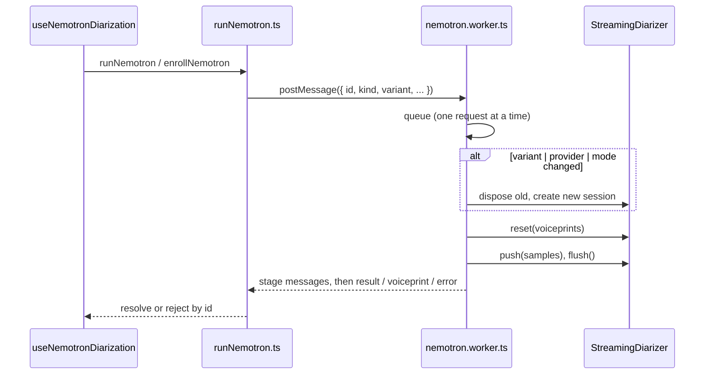

# Nemotron diarization runtime: maintainer notes

Browser port of Nemotron 3 Diarization used by `useNemotronDiarization` and
`SpeakerScribe`. Experimental and not exported. Consumer guidance lives in the
**Modules / Voice / Speaker Scribe** story; these notes cover how to change the
runtime safely.

Ported from `khawjaahmad/nemotron-diarization-web@0dc1980` (MIT, see
[LICENSE](./LICENSE)). Files carrying that header (`diarizer.ts`,
`speakerCache.ts`, `featureExtractor.ts`, `mel.ts`, `fft.ts`, `tensor.ts`,
`modelConfig.ts`) should stay close to upstream so fixes can be compared.

## Request and session lifecycle

- **One worker per page, one session per worker.** `runNemotron.ts` lazily
  creates a module-level worker and matches replies by `id`. If the worker
  script fails to load, it is terminated and the next request starts a fresh one.
- **Requests are serialised.** The worker chains every message on one promise
  because the session and speaker cache are shared state. Never run two
  requests on the session concurrently.
- **The session is cached by `variant|executionProvider|streamingMode`.** A
  change disposes the old session first. `loadMs` is 0 when the session is reused.
- **`reset(voiceprints)` runs before every request.** It replaces the speaker
  cache and all buffering cursors, so no state leaks between clips. Enrollment
  and diarization share the same reset path.
- **ONNX Runtime is single-threaded inside the worker** (`numThreads = 1`):
  nested pthread workers deadlock. A failed ORT import clears its cached
  promise so the next request retries.

## Coupling between preprocessing, the speaker cache and voiceprints

A stored voiceprint is a block of **speaker-cache frames** (`frames x
hiddenSize`) captured by `SpeakerCache.voiceprint()` after enrollment, not a
generic embedding. It is only meaningful to the exact pipeline that produced it:

- **Checkpoint:** `MODEL_REVISION` in `modelConfig.ts` pins the Hugging Face
  revision. Voiceprints are stamped with it and with the `variant`;
  `isUsableWith` rejects any mismatch, and the UI shows "re-enroll".
- **Preprocessing:** `featureExtractor.ts`, `mel.ts` and `fft.ts` must match the
  checkpoint's `processor_config.json`. A change to the mel filterbank,
  windowing, pre-emphasis or normalisation changes the encoder frames and
  silently invalidates stored voiceprints even with the same revision.
- **Streaming mode:** enrollment and diarization both use `offline`. The cache
  sizes come from `streamingConfigFor`; enrolling in one mode and seeding in
  another is untested.
- **Lane order:** `SpeakerCache.seed` puts voice `i` in lane `i` with one-hot
  probabilities. `laneNames` in `attribution.ts` assumes the first `n` lanes are
  the enrolled names in the order passed. `MAX_VOICES` (7) keeps one of the 8
  lanes free for unenrolled people.

**If you change preprocessing or seeding**, add a version to the voiceprint
stamp and check it in `isUsableWith`, so old prints are rejected rather than
misread. A new `MODEL_REVISION` already rejects them.

Voiceprints live in IndexedDB under `ozwellNemotronVoiceprints`, scoped by
`voiceprintNamespace` through `voiceprintStore`, separately from TitaNet prints.

## Asset configuration

| Asset            | Where it is set                                         | Notes                                                                 |
| ---------------- | ------------------------------------------------------- | --------------------------------------------------------------------- |
| ONNX Runtime Web | `ORT_VERSION` / `ORT_BASE` in `nemotron.worker.ts`      | Loaded from jsDelivr at runtime; `wasmPaths` points at the same base. |
| Model and config | `MODEL_BASE_URL` / `MODEL_REVISION` in `modelConfig.ts` | Hugging Face `onnx-community/Nemotron-3-Diarization-ONNX`.            |

`model_quantized` (int8, ~121 MB) is the default. On WebGPU only the fp32
`model` builds. There is no host override yet; self-hosting the assets means
changing these constants.

## Validating a port or upgrade

1. Run the unit tests: `pnpm vitest run src/components/AI/HeyOzwell/nemotron src/components/AI/HeyOzwell/speakerEdits.test.ts`.
   `featureExtractor.test.ts` and `speakerCache.test.ts` pin the preprocessing
   and cache behaviour; `attribution.test.ts` pins word-to-lane mapping.
2. In Storybook, open **Modules / Voice / Speaker Scribe → Scribe** and analyse
   a known two-person clip with overlap. Lanes, overlap badges and timings
   should match the upstream demo at the pinned commit for the same clip and
   variant.
3. Enroll a voice, reload the page and re-analyse: the stored voice must still
   name its lane. After a revision or preprocessing change, old voices must show
   "re-enroll".
4. Try both `wasm` and, where available, `webgpu` with `model`.
