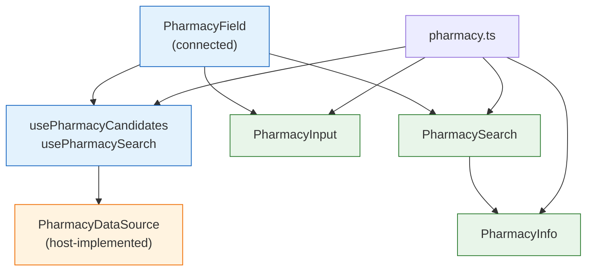

# Pharmacy maintainer notes

How to change `PharmacyInput`, `PharmacySearch`, `PharmacyField` and their rules safely. Consumer docs live in the story descriptions.

## Layers

- **`pharmacy.ts` is the single source of the domain rules.** `pharmId` parsing, classification, the default selection, search params and display strings live there and nowhere else. The components call it; they never test `serviceLevel` bits or the `N` prefix directly.
- **Presentational components never fetch and never time anything.** No debounce or abort in `PharmacyInput` or `PharmacySearch`; that belongs in `usePharmacyData.ts`, so hosts that hold their own state are not affected.
- **The connected layer knows no URLs.** It only awaits `PharmacyDataSource` functions.

## Invariants

- **State is per patient.** `PharmacyField` keys its body by `patId`; never hoist the override or selection above that key.
- **A save never outlives its dialog.** `PharmacySearch` blocks dismissal while saving and ignores a settle after unmount, so it can't close or overwrite a reopened search.
- **Results always match the current criteria.** Rows are hidden while `resultsLoading`, and `initialFilters` stop replacing the filters once the user edits them.
- **No implicit form submission.** Enter in a dialog text input is cancelled at `ModalBody` because `Modal` renders inside the host's `<form>`.
- **`required` uses custom validity.** The `"0"` placeholder is non-empty, so `PharmacyInput` sets the select's custom validity instead of relying on native `required`.

- **Fixed WebChart defects stay fixed.** Each has a test:
  - Make Preferred is disabled without a selection, and `preferredPharmacyChoice` returns `null` for an empty id, so the mail-order slot is never cleared by accident.
  - Only one candidate is selected when the patient has a local and a mail-order preferred pharmacy.
  - `"0"` and `""` both mean "no pharmacy" (`normalizePharmId`), including as the search prefill.
  - The 6-digit phone/fax rule counts digits, not characters.
  - Save failures keep the modal open; success closes it once.
- **`onSearchRequest` fires once per distinct request.** `PharmacySearch` keys an effect on the serialized params. A picked row's description is not treated as a new name search (`searchText` is empty while `query === pickedLabel`).
- **Late results are dropped even if a source ignores `signal`.** `useLatestRequest` checks `controller.signal.aborted` before applying a result.
- **The uncontrolled `PharmacyInput` applies the default during render**, then reports it from an effect. Hosts reading the DOM in their own effects (e.g. `transmitOptionSet`) see the new selection.
- **Legacy form contract.** Select `name="pharmacy"`, placeholder `"0"`, hidden `pharm_id`, and raw `ncpdpid` / `npi` / `newrx` option attributes are read by WebChart's `refill_id.html`. Don't rename them; the `data-*` twins are for new hosts.

- **Focus return lives in `PharmacySearch`** (`useReturnFocus`), because `Modal`'s `useFocusTrap` does not restore focus. It prefers `returnFocusRef`, since Safari and macOS Firefox do not focus a clicked button; the `document.activeElement` fallback is captured in a layout effect, before the trap moves focus. Remove it if `Modal` gains focus restore.
- **`transmitRoute` is the only transmit rule in the library.** MedicationEditor's Transmission row (`MedicationList/MedicationPharmacyFields.tsx`) enables Transmit from it. Keep it in step with PharmacyInfo's New / Fax Only / Print Only branches. Broader readiness (prescriber, EPCS, PDMP) belongs to draft PR #538's `validatePrescription`, whose `transmit` stage currently rejects fax-only pharmacies.
- **Selection reset rules differ by layer.** Uncontrolled `PharmacyInput` reapplies the default when the list's _contents_ change (a new array with the same ids keeps the user's choice). `PharmacyField` controls the input and reapplies per completed _load_, so choosing the same pharmacy again still selects it.

## Autocomplete usage

- The search and city fields pass only `name`, `onBlur`, `onFocusCapture` and ARIA attributes through `inputProps`. Autocomplete spreads `inputProps` after its own handlers, so `onFocus`, `onKeyDown` or `onChange` there would break the combobox.
- Phone/fax results appear in the Search list, which only opens when that input is focused or typed in. The number field's Tab/Enter handler focuses it; keep that, or results are invisible.
- Escape inside the result list must not close the modal; Autocomplete stops propagation while its list is open (see `Autocomplete.test.tsx`).
- Picking a result does not blur the input (options cancel `mousedown`), so the free-text clear on blur cannot race the pick.

## Fixtures

`storyData.ts` serves both stories and tests. The fake search is deliberately simple; do not grow it into the server's multi-pass algorithm. Each `createFakePharmacySource()` copies the patients, so saving in one story or test does not leak into another. Keep fixture names and numbers fictional (555-01xx).

## Tests

- `pharmacy.test.ts`: rule tables.
- `PharmacyInput.test.tsx`, `PharmacySearch.test.tsx`: presentational behavior with plain props.
- `PharmacyField.test.tsx`: the connected layer against the fake source with fake timers (debounce, abort, reload, save failure).

Changes that affect rendering need the visual baselines updated (`pnpm test:visual`) and reviewed.
